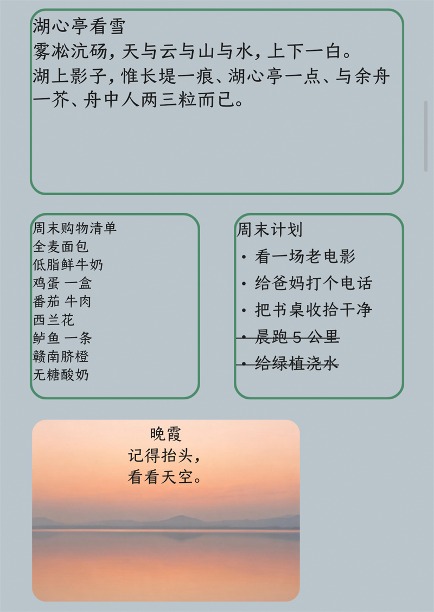
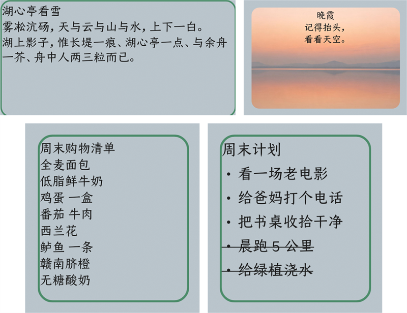
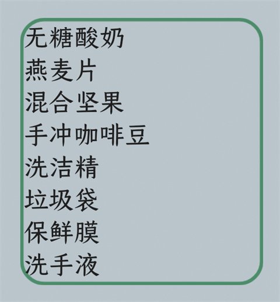
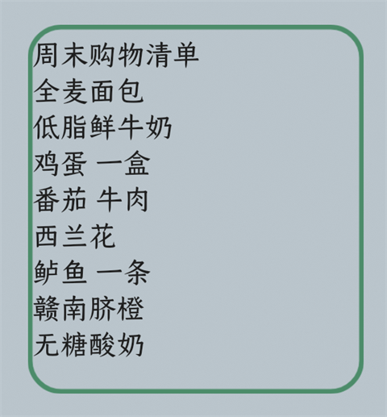
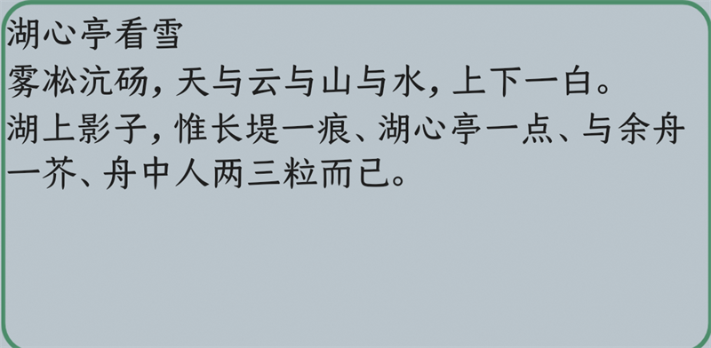
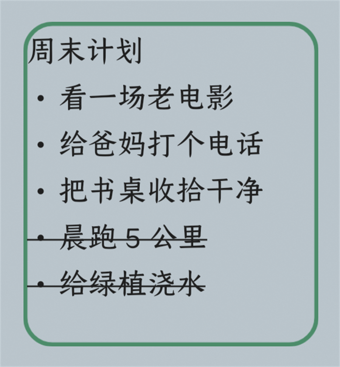
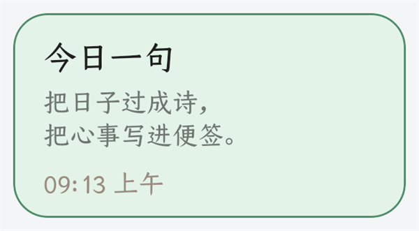
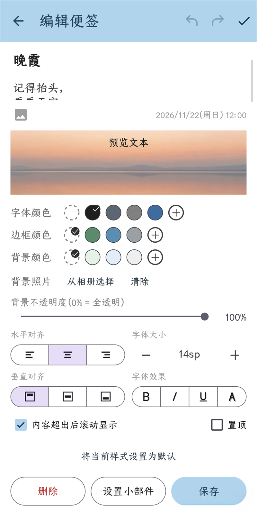
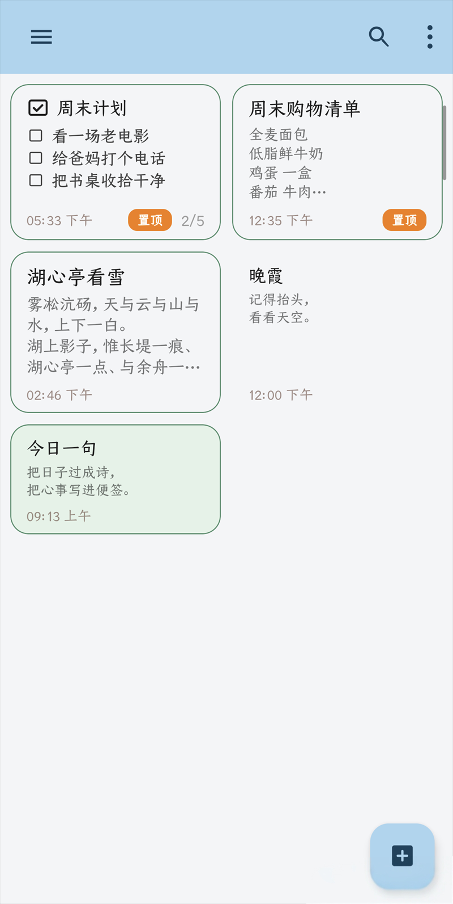
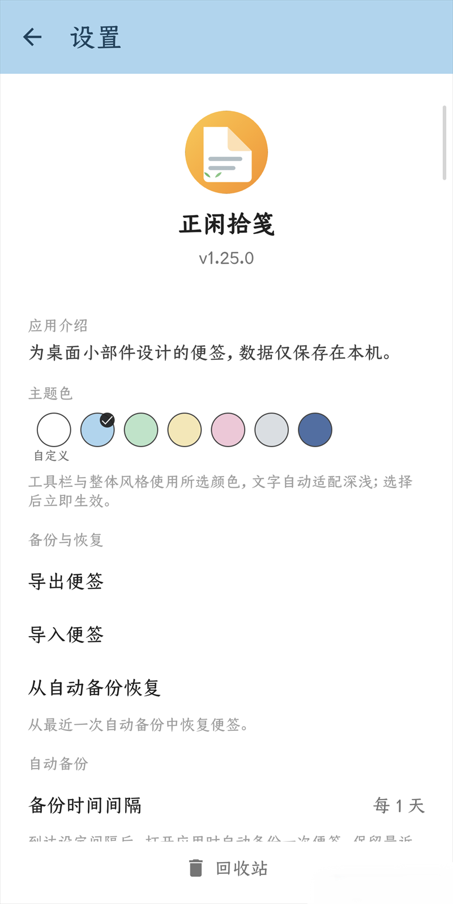

# 正闲拾笺（MemoWidget）


Android 本地便签 + 待办应用，主打**桌面小部件**：把任意一条便签或待办贴到桌面，随时可见、随手可改。



> **数据仅保存在本机。** 应用不申请任何权限、没有任何网络代码，内容不出设备。卸载前请用应用内「备份与恢复」导出 JSON。

## 功能速览



| 能力 | 说明 |
| --- | --- |
| 桌面便签部件 | 最小 1×1、双向自由拉伸，绑定任意便签或待办 |
| 便签 + 待办 | 待办勾选、删除线、未完成/已完成自动分组 |
| 样式自定义 | 背景/边框/字体预设色板与自定义取色、字号、对齐、字体效果 |
| 照片 | 便签照片（最多 10 张）、部件背景照片、不透明度调节 |
| 零权限 | 无网络、无存储权限，数据 100% 本机 |
| 数据安全 | 导出/导入 JSON、自动备份、回收站 |

## 桌面小部件

添加部件：长按桌面空白处 →「小部件」→ 找到「正闲拾笺」→ 拖到桌面，配置页里点选要绑定的便签或待办（也可当场新建）。

- **尺寸**：最小 1×1，横向、纵向自由拉伸（最大 320dp），排版随尺寸自动重排；
- **绑定**：一个部件绑定一条便签或待办，点开配置页即可换绑；
- **两种显示模式**（编辑页「内容超出后滚动显示」开关）：

| 滚动模式 | 静态模式 |
| --- | --- |
| 内容超出部件高度时，在部件上上下滑动查看 | 固定排版：按部件实际高度计算容量、超出自动截断，所见即全部 |
|  |  |

长文便签也能整段贴上桌面，当作一页「桌面诗笺」：



## 排版精修

待办部件为可读性做了专门处理：



- 未完成 / 已完成自动分组，已完成条目加删除线，勾选顺序不乱；
- 长条目自动折行并悬挂缩进，勾选框与后续文字对齐；
- 可选「隐藏已完成」，只看眼前要做的事；
- 主列表卡片带进度角标（如 2/5），完成情况一眼可见。

## 样式与个性化

内置官方色板，也支持自定义取色（自动记录最近使用）：

| 背景 | 边框 | 字体 |
| --- | --- | --- |
| 薄荷 · 天青 · 中性灰 | 森绿 · 湖蓝 · 暖灰 | 墨黑 · 冷灰 · 中性灰 · 天青蓝 |

- 字号、水平对齐、垂直对齐，加粗 / 斜体 / 下划线 / 投影，逐项可调；
- 薄荷底、居中排版的样子：



- 便签可用相册照片作部件背景，配合「不透明度」滑块调节浓淡，文字浮于照片之上：


- 应用主题色 7 种（含自定义取色），工具栏与整体风格联动、文字深浅自动适配。

## 编辑器与图片



- 标题 + 正文编辑，撤销 / 重做随时回退；返回不保存则不残留空便签；
- 底部「设置小部件」展开完整样式面板：实时预览、三行色板、背景照片、不透明度、对齐、字号、字体效果一屏调完；
- 便签照片最多 10 张，支持裁剪、大图浏览、快捷删除；
- 部件背景照片从相册选择，随时清除。

主页提供四种查看方式（列表 / 双列卡片 / 网格 / 标题）与三种排序（修改时间 / 添加时间 / 标题），支持置顶与搜索：



## 数据与隐私



- **零权限**：不申请任何系统权限，没有网络访问，数据只存在应用私有目录；
- **手动备份**：导出 / 导入 JSON，照片以 base64 内嵌，一个文件全带走；
- **自动备份**：按所选间隔自动快照，「从自动备份恢复」一键找回；
- **回收站**：软删除机制，删错的便签随时恢复或彻底删除。

## 构建

纯命令行构建，无需 Android Studio：

- JDK 17
- Android SDK Platform 34 + Build-Tools 34
- Gradle 8.7（仓库已含 wrapper，可直接使用 `gradlew`）

```bash
# Windows
gradlew.bat assembleDebug
# Linux / macOS
./gradlew assembleDebug
```

产物位置：`app/build/outputs/apk/debug/app-debug.apk`

首次构建前，把本机 SDK 路径写入 `local.properties`（已被 .gitignore 忽略，不会入库）：

```properties
sdk.dir=D\:\\path\\to\\Android\\Sdk
```

Release 签名：在仓库根目录放置 `keystore.properties`（同样不入库），

```properties
storeFile=your.jks
storePassword=******
keyAlias=******
keyPassword=******
```

之后 `gradlew assembleRelease` 即产出已签名 APK；没有该文件时 release 自动退化为未签名构建，不影响开发调试。

依赖仓库已配置阿里云镜像源（见 `settings.gradle`），国内网络可直接拉取。

## FAQ

**桌面上怎么添加部件？**
长按桌面空白处 →「小部件」→ 正闲拾笺，拖到桌面后在配置页选择绑定的便签或待办。也可以长按应用图标，通过快捷方式「新建便签」直接动笔，或「添加小部件」发起系统 pin 请求（Android 8+）。

**换手机、重装系统怎么迁移数据？**
旧机「导出便签」生成 JSON，传到新机后「导入便签」，照片一并还原。注意：卸载应用会清除全部数据，务必先导出。

**部件内容会自动更新吗？**
便签保存后部件即时刷新；调整部件尺寸后排版自动重算。个别桌面（如 MIUI 偶发的部件缓存时序）显示异常时，重进一次应用即可触发全量刷新。

## 许可证

[MIT](LICENSE) © 2026 jcbyccz

开源仓库：https://github.com/jcbyccz/MemoWidget
